# Vektra POS — Propuesta de arquitectura

## 0. Modelo de despliegue (acordado el 2026-11-16)

Vektra vende el sistema **cliente por cliente**: cada negocio paga **su propia VPS** y Vektra instala ahí el sistema. Por eso hay dos productos:

```
┌──────────────── VPS de Vektra ────────────────┐        ┌──────── VPS del cliente (ej. Ferretería X) ────────┐
│  VEKTRA HUB  (apps/hub-api + apps/hub-web)    │        │  INSTANCIA  (api + worker + web + postgres + redis) │
│  · clientes, planes, suscripciones            │◀──────▶│  · 1..n empresas (RUC) del mismo dueño             │
│  · emisión de licencias firmadas (Ed25519)    │ HTTPS  │  · valida licencia cada hora; tolera 48 h sin Hub  │
│  · cobro mensual: factura electrónica Vektra, │        │  · reporta uso, caducidad de firma y errores SRI   │
│    link Payphone/Deuna, suspensión automática │        │                                                     │
│  · telemetría: uso, firmas por caducar,       │        │   ▲ cajas de escritorio (Electron + SQLite)         │
│    errores SRI de todos los clientes          │        │   └─ conectadas a la API de la instancia            │
└───────────────────────────────────────────────┘        └─────────────────────────────────────────────────────┘
```

- **Se mantiene `tenant_id` + RLS dentro de cada instancia.** Cuesta poco, permite que un mismo dueño tenga varios RUC en su VPS y cumple el criterio de aislamiento entre empresas. También deja abierta una futura modalidad SaaS compartida.
- **El “Panel Superadmin” pasa a ser el Vektra Hub.** En cada instancia queda un rol técnico **“Soporte Vektra”** para la instalación y el mantenimiento.
- **Licencia:** el Hub emite un token firmado con los límites del plan. La instancia lo verifica con la clave pública incluida en ella, aunque no tenga conexión. Si pasan **48 h** sin validar, **se bloquea la emisión de comprobantes** (el resto queda en solo lectura) hasta que vuelva a validar o se ingrese un **código de activación offline** que Vektra entrega por teléfono o WhatsApp. Así una caída del Hub no deja a todos los clientes sin facturar.
- **Cobro (Fase 8):** el Hub genera el cargo mensual, emite la factura electrónica de Vektra con el mismo `@vektra/sri-core`, envía el link de pago (Payphone o Deuna), concilia los pagos por webhook y suspende la licencia tras el período de gracia.
- **Por cada empresa:** SMTP propio, credenciales de WhatsApp Business (Cloud API de Meta) opcionales con respaldo `wa.me`, y Payphone/Deuna en dos modos: solo registro manual o integración por API (QR o link con confirmación automática).
- **Modo offline de la caja:** crea clientes, productos, ventas y notas de crédito. Todo usa UUID generado en el cliente. Al sincronizar, los clientes se fusionan por número de identificación; si un código de producto choca con otro, el producto queda marcado como “conflicto” para revisión. El stock negativo es configurable por empresa.

## 1. Decisiones clave

| Tema | Propuesta | Motivo |
|---|---|---|
| Monorepo | **Nx + pnpm** | Nx trae soporte de primera clase para Angular + NestJS + librerías TS, caché de builds y `affected`. |
| UI | **Angular Material 22** (Material 3), fuentes e íconos empaquetados localmente | *Cambio en Fase 0:* PrimeNG 22 exige licencia comercial de pago (muestra "Invalid PrimeUI License" sin ella). Material es MIT y mantenido por el equipo de Angular. Fuentes locales para que la caja funcione sin internet. |
| Versiones | Nx 24, Angular 22, NestJS 12 (ESM), Prisma 7.10 (driver adapter `pg`), TypeScript 6, Node 22 | Últimas estables a nov-2026. Prisma 8 aún está en RC. |
| Pruebas | Jest en librerías puras; **Vitest + SWC** en apps NestJS | NestJS 12 es ESM y Jest no lo carga; SWC conserva los metadatos de decoradores que necesita la inyección de Nest. |
| Multi-tenant | BD compartida, `tenant_id` en todas las tablas + **RLS de PostgreSQL** | Se fija `SET LOCAL app.tenant_id` en cada transacción mediante una extensión del cliente Prisma; la app se conecta con un rol **sin** `BYPASSRLS`. El superadmin usa una conexión aparte. |
| Worker | App `worker` separada (BullMQ) que comparte código con la API | Envío/autorización SRI, correos, alertas de firma y respaldos sin bloquear la API; escala por separado. |
| Escritorio | Electron carga la misma app Angular; **better-sqlite3** con un esquema local reducido (no Prisma) | Prisma no permite el mismo esquema en PG y SQLite con RLS/jsonb; el esquema local solo contiene catálogo, stock en caché, ventas y la cola de salida (outbox). |
| Secuenciales | Tabla `sequence_counter` por (punto de emisión, tipo de comprobante) con `UPDATE … RETURNING` dentro de la transacción. Cada caja de escritorio **es dueña** de su punto de emisión; el servidor nunca emite con ese punto | Sin saltos ni duplicados, aunque haya modo offline. |
| Sincronización | Outbox local con UUIDs generados en el cliente (idempotentes) → `POST /sync/push`; el catálogo baja por `GET /sync/pull?since=` | Simple, idempotente y auditable. |
| Firma XAdES-BES | `node-forge` (PKCS#12) + canonicalización C14N propia/`xml-crypto` dentro de `@vektra/sri-core` | TypeScript puro: funciona igual en el servidor y en Electron. |
| RIDE | Plantilla HTML (Handlebars) → PDF con Chromium (Puppeteer en el servidor, `webContents.printToPDF` en Electron) | Una sola plantilla para los dos entornos. |
| Validación XSD | `libxmljs2`/`xmllint-wasm` con los XSD oficiales del SRI versionados en `libs/sri-core/xsd/` | Validar antes de firmar. |
| Montos | `Decimal(18,6)` en BD, `decimal.js` en el código, redondeo a 2 decimales solo en los totales del XML | Evita errores de punto flotante en los impuestos. |

> **Nota SRI:** en el esquema *offline* el tipo de emisión es siempre `1` (normal). Propongo que el estado “en contingencia” signifique **“firmado localmente, pendiente de envío”**, no un tipo de emisión distinto. Lo verificaré contra la Ficha Técnica vigente en la Fase 1 junto con el plazo máximo de envío.

## 2. Estructura del monorepo

```
vektra/
├─ apps/
│  ├─ api/                 NestJS (REST + OpenAPI)
│  ├─ worker/              NestJS standalone: procesadores BullMQ (SRI, correo, alertas, respaldos)
│  ├─ web/                 Angular: back-office + POS + /superadmin (lazy, con guard)
│  ├─ desktop/             Electron: main, preload, SQLite, sync, impresión térmica (ESC/POS)
│  ├─ hub-api/             Vektra Hub: licencias, planes, cobro, telemetría (BD propia)
│  └─ hub-web/             Vektra Hub: panel Angular de Vektra
├─ libs/
│  ├─ sri-core/            @vektra/sri-core — clave de acceso, cálculo de impuestos, XML, XSD, firma, cliente SOAP, RIDE
│  ├─ shared/contracts/    DTOs + esquemas zod compartidos front/back/desktop
│  ├─ shared/domain/       reglas puras: totales de venta, validación de cédula/RUC, permisos, conversión de unidades
│  ├─ db/                  esquema Prisma, migraciones, políticas RLS (SQL), seeds (catálogos SRI, plantillas de negocio)
│  ├─ api/<módulo>/        módulos Nest por dominio (auth, tenants, catalog, inventory, sales, sri, cash…)
│  └─ web/ui, web/<feature>/  componentes y features de Angular
├─ docker/                 Dockerfiles, docker-compose.yml (api, worker, web, postgres, redis, mailpit)
├─ docs/
└─ tools/                  scripts (generadores, importación de XSD)
```

## 3. Modelo de datos (entidad-relación)

Convenciones: todas las tablas de negocio llevan `tenant_id`, `created_at`, `updated_at` y `created_by`. Los IDs son UUID v7 (ordenables y generables offline). Todos los valores tributarios viven en tablas, no en el código.

```mermaid
erDiagram
    %% ===== Plataforma / SaaS =====
    PLAN ||--o{ SUBSCRIPTION : "define límites"
    TENANT ||--o{ SUBSCRIPTION : tiene
    TENANT ||--o{ TENANT_MODULE : activa
    BUSINESS_TEMPLATE ||--o{ TENANT : "plantilla inicial"
    TENANT ||--o{ USAGE_COUNTER : "uso mensual"
    TENANT ||--o| LICENSE : "on-premise"

    PLAN { uuid id string code json limits decimal price }
    TENANT { uuid id string ruc string razon_social string nombre_comercial string regimen int ambiente bool obligado_contabilidad string contribuyente_especial string status json branding }
    SUBSCRIPTION { uuid id date starts_at date ends_at string status json limit_overrides }
    TENANT_MODULE { uuid tenant_id string module_code bool enabled json settings }
    BUSINESS_TEMPLATE { string code json modules json default_fields }
    USAGE_COUNTER { uuid tenant_id string period int documents_issued int users int registers }
    LICENSE { uuid id string machine_fingerprint datetime last_validated_at string status }

    %% ===== Seguridad =====
    TENANT ||--o{ USER : tiene
    TENANT ||--o{ ROLE : define
    ROLE ||--o{ ROLE_PERMISSION : ""
    PERMISSION ||--o{ ROLE_PERMISSION : ""
    USER ||--o{ USER_ROLE : ""
    ROLE ||--o{ USER_ROLE : ""
    USER ||--o{ REFRESH_TOKEN : ""
    TENANT ||--o{ AUDIT_LOG : ""

    USER { uuid id uuid tenant_id string email string password_hash bool is_superadmin string totp_secret_enc int failed_attempts datetime locked_until }
    ROLE { uuid id uuid tenant_id string name bool is_system }
    PERMISSION { string code string description }
    USER_ROLE { uuid user_id uuid role_id uuid establishment_id }
    REFRESH_TOKEN { uuid id uuid user_id string token_hash datetime expires_at datetime revoked_at }
    AUDIT_LOG { uuid id uuid tenant_id uuid user_id string entity uuid entity_id string action json before json after datetime at string ip }

    %% ===== Estructura SRI de la empresa =====
    TENANT ||--o{ ESTABLISHMENT : ""
    ESTABLISHMENT ||--o{ EMISSION_POINT : ""
    ESTABLISHMENT ||--o{ WAREHOUSE : ""
    EMISSION_POINT ||--o{ SEQUENCE_COUNTER : ""
    EMISSION_POINT ||--o| DEVICE : "caja escritorio dueña"
    TENANT ||--o{ CERTIFICATE : "firma .p12"

    ESTABLISHMENT { uuid id string code_3 string address string name }
    EMISSION_POINT { uuid id string code_3 string kind "web|desktop" }
    SEQUENCE_COUNTER { uuid emission_point_id string doc_type bigint next_value }
    DEVICE { uuid id string name string fingerprint datetime last_sync_at string status }
    CERTIFICATE { uuid id bytes p12_enc bytes password_enc string subject date valid_from date valid_to bool active }
    WAREHOUSE { uuid id uuid establishment_id string name }

    %% ===== Catálogos tributarios (globales, versionados por vigencia) =====
    TAX_TYPE ||--o{ TAX_RATE : ""
    TAX_TYPE { string code "2=IVA 3=ICE 5=IRBPNR" string name }
    TAX_RATE { uuid id string tax_code string percentage_code decimal rate date valid_from date valid_to }
    SRI_CATALOG { string catalog "forma_pago|tipo_ident|cod_retencion|…" string code string description date valid_from date valid_to }
    SRI_SETTING { string key json value date valid_from }
    DOC_TYPE_VERSION { string doc_type string xml_version date valid_from }

    %% ===== Productos =====
    TENANT ||--o{ PRODUCT : ""
    CATEGORY ||--o{ PRODUCT : ""
    BRAND ||--o{ PRODUCT : ""
    UNIT ||--o{ PRODUCT : "unidad base"
    PRODUCT ||--o{ PRODUCT_BARCODE : ""
    PRODUCT ||--o{ PRODUCT_UNIT : "conversiones"
    PRODUCT ||--o{ PRODUCT_TAX : ""
    TAX_RATE ||--o{ PRODUCT_TAX : ""
    PRICE_LIST ||--o{ PRODUCT_PRICE : ""
    PRODUCT ||--o{ PRODUCT_PRICE : ""
    PRODUCT ||--o{ PRODUCT_VARIANT : "módulo variantes"

    PRODUCT { uuid id string code string name uuid base_unit_id bool allows_fraction bool tracks_lots bool tracks_serials decimal avg_cost decimal min_stock string image_url json custom_fields bool active }
    PRODUCT_BARCODE { uuid id uuid product_id uuid variant_id string barcode uuid unit_id }
    PRODUCT_UNIT { uuid product_id uuid unit_id decimal factor }
    PRODUCT_TAX { uuid product_id string tax_code uuid tax_rate_id }
    PRICE_LIST { uuid id string name "público|mayorista|distribuidor" }
    PRODUCT_PRICE { uuid price_list_id uuid product_id uuid unit_id decimal price bool includes_tax }
    PRODUCT_VARIANT { uuid id uuid product_id string sku json attributes }
    CUSTOM_FIELD_DEF { uuid id uuid tenant_id string entity string key string label string type json options bool required }

    %% ===== Inventario =====
    WAREHOUSE ||--o{ STOCK : ""
    PRODUCT ||--o{ STOCK : ""
    PRODUCT ||--o{ INVENTORY_MOVEMENT : kardex
    WAREHOUSE ||--o{ INVENTORY_MOVEMENT : ""
    PRODUCT ||--o{ LOT : "módulo lotes"
    PRODUCT ||--o{ SERIAL_NUMBER : "módulo series"

    STOCK { uuid warehouse_id uuid product_id uuid variant_id uuid lot_id decimal quantity }
    INVENTORY_MOVEMENT { uuid id string type "venta|compra|ajuste|transfer|devol" decimal qty decimal unit_cost decimal avg_cost_after decimal balance_after uuid document_id string reason datetime at }
    LOT { uuid id string number date expires_at }
    SERIAL_NUMBER { uuid id string serial string status uuid sold_document_id date warranty_until }

    %% ===== Terceros =====
    TENANT ||--o{ PARTY : "clientes y proveedores"
    PARTY { uuid id string id_type "04 RUC|05 cédula|06 pasaporte|07 CF" string identification string name string email string phone string address bool is_customer bool is_supplier uuid price_list_id decimal credit_limit json custom_fields }

    %% ===== Documentos (comercial + electrónico) =====
    PARTY ||--o{ DOCUMENT : ""
    EMISSION_POINT ||--o{ DOCUMENT : ""
    DOCUMENT ||--o{ DOCUMENT_LINE : ""
    DOCUMENT_LINE ||--o{ DOCUMENT_LINE_TAX : ""
    DOCUMENT ||--o{ DOCUMENT_PAYMENT : ""
    DOCUMENT ||--o| ELECTRONIC_DOC : "ciclo SRI"
    ELECTRONIC_DOC ||--o{ ELECTRONIC_DOC_EVENT : historial
    DOCUMENT ||--o{ DOCUMENT : "NC/ND/retención → documento sustento"
    DOCUMENT ||--o{ WITHHOLDING_LINE : "retenciones"

    DOCUMENT { uuid id string kind "01|03|04|05|06|07|proforma|compra" string direction "emitido|recibido" string sequential datetime issue_date decimal subtotal decimal discount decimal total string status uuid related_document_id uuid cash_session_id uuid device_id json extra }
    DOCUMENT_LINE { uuid id uuid product_id uuid variant_id uuid lot_id uuid unit_id string description decimal qty decimal unit_price decimal discount decimal subtotal }
    DOCUMENT_LINE_TAX { uuid line_id string tax_code string percentage_code decimal rate decimal base decimal amount }
    DOCUMENT_PAYMENT { uuid id string sri_payment_code string method "efectivo|tarjeta|transf|deuna|payphone|credito" decimal amount int term_days string reference }
    ELECTRONIC_DOC { uuid document_id string access_key_49 int environment string status "borrador|firmado|enviado|recibido|devuelto|autorizado|no_autorizado|pendiente_envio" string xml_signed_path string xml_authorized_path string ride_path datetime authorized_at int attempts }
    ELECTRONIC_DOC_EVENT { uuid id string from_status string to_status json sri_messages datetime at }
    WITHHOLDING_LINE { uuid id string tax_code string retention_code decimal base decimal rate decimal amount }

    %% ===== Caja =====
    EMISSION_POINT ||--o{ CASH_REGISTER : ""
    CASH_REGISTER ||--o{ CASH_SESSION : ""
    USER ||--o{ CASH_SESSION : ""
    CASH_SESSION ||--o{ CASH_MOVEMENT : ""
    CASH_SESSION ||--o{ DOCUMENT : ""

    CASH_REGISTER { uuid id string name }
    CASH_SESSION { uuid id datetime opened_at decimal opening_amount datetime closed_at json counted_amounts json expected_amounts decimal difference }
    CASH_MOVEMENT { uuid id string type "ingreso|egreso" decimal amount string reason }

    %% ===== Cuentas por cobrar / pagar =====
    DOCUMENT ||--o{ ACCOUNT_ENTRY : "genera saldo"
    ACCOUNT_ENTRY ||--o{ ACCOUNT_PAYMENT : abonos
    ACCOUNT_ENTRY { uuid id string kind "cxc|cxp" uuid party_id decimal amount decimal balance date due_date }
    ACCOUNT_PAYMENT { uuid id decimal amount string method datetime at }

    %% ===== Sincronización escritorio =====
    DEVICE ||--o{ SYNC_BATCH : ""
    SYNC_BATCH { uuid id datetime received_at int items json result }
```



### Notas del modelo
- **Separación Hub ↔ instancia:** `PLAN`, `SUBSCRIPTION`, `USAGE_COUNTER` y la emisión de `LICENSE` viven en la **BD del Hub**, junto con `HUB_CLIENT`, `INSTALLATION`, `INVOICE_CHARGE` y `PAYMENT`. La instancia solo guarda `INSTANCE_LICENSE` (el token vigente, la última validación y los límites) y envía su uso al Hub.
- **`DOCUMENT` + `ELECTRONIC_DOC`:** el documento comercial (incluye proformas y compras recibidas) va separado de su ciclo de vida en el SRI. Así, una proforma no tiene `ELECTRONIC_DOC`, y una factura de proveedor importada por XML usa `direction = recibido`. Los campos propios de cada tipo (destinatarios de la guía, motivo de la ND, etc.) van en `extra` (jsonb), validados con zod según el tipo.
- **Impuestos por línea** se guardan *congelados* (`DOCUMENT_LINE_TAX`) con el código y la tarifa vigentes al momento de vender: si cambias la tarifa en configuración, solo afecta a las ventas nuevas.
- **`TAX_RATE`, `SRI_CATALOG`, `SRI_SETTING`** son globales (sin tenant) y tienen vigencia por fechas. Ahí van, por ejemplo, el monto máximo para consumidor final, las URLs de los web services y las leyendas RIMPE.
- **Variantes, lotes y series** existen en el esquema desde el inicio (columnas nulas) para no migrar datos después; la UI los muestra solo si `TENANT_MODULE` los tiene activos.
- **RLS:** una política genérica `tenant_id = current_setting('app.tenant_id')::uuid` en cada tabla con tenant, y una prueba automática que intenta leer datos entre dos empresas.

## 4. Alcance de la Fase 0 (implementada el 2026-11-16)
1. Workspace Nx + pnpm, ESLint/Prettier, Jest/Vitest, CI básico.
2. `docker-compose`: postgres 17, redis 7, mailpit, api, worker, web.
3. `libs/db`: modelos de plataforma + seguridad + estructura SRI (establecimientos, puntos de emisión, secuenciales), RLS y seeds.
4. Auth: login, JWT de acceso (15 min) + refresh rotativo, bloqueo tras N intentos, 2FA TOTP opcional.
5. Roles/permisos granulares + guards en Nest + directivas en Angular.
6. Bitácora de auditoría (interceptor).
7. Superadmin mínimo: CRUD de empresas, planes y suspensión.
8. Prueba e2e de aislamiento entre empresas.
